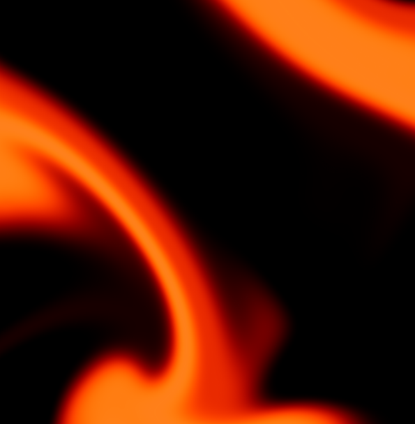
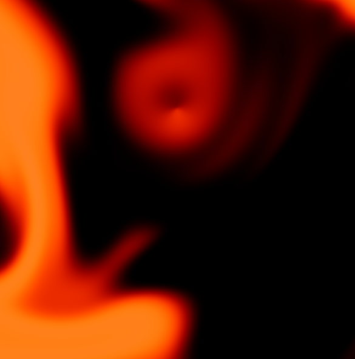

# Práctica S9: Shaders — Lava Interactiva (*Tiny Code*)

**Autor:** Alejandro Celis Hernández Delgado  
**Asignatura:** Informática Gráfica  
**Entorno de ejecución:** [The Book of Shaders Editor](https://editor.thebookofshaders.com/)

## 1. Motivación

El objetivo de esta práctica es diseñar un **shader de fragmentos** en GLSL que genere un patrón dinámico y orgánico, cumpliendo además con el reto ***tiny code*** (un tamaño máximo de **512 bytes** sin contar comentarios e incluyendo la declaración de los `uniform`).

La idea elegida es simular la superficie de un fluido incandescente similar a **lava volcánica** que fluye de manera continua y reacciona de forma natural al paso del puntero del ratón: al acercar el cursor, el magma se desplaza suavemente hacia los lados y aumenta su temperatura local, apagándose el efecto de forma progresiva cuando el ratón sale del lienzo.

El principal desafío técnico ha consistido en lograr una apariencia fluida, orgánica y con interacción realista dentro de una restricción de espacio tan estricta, lo que obligó a descartar algoritmos extensos como el ruido de Perlin o *Value Noise* clásico y buscar una alternativa matemática mucho más compacta.

## 2. Desarrollo del Shader

El algoritmo se ha estructurado en cinco etapas clave ejecutadas en paralelo para cada fragmento en la GPU:

### 2.1. Normalización de coordenadas y relación de aspecto

Se normalizan tanto las coordenadas del píxel (`gl_FragCoord.xy`) como la posición del cursor (`u_mouse`) dividiendo entre `u_resolution`, obteniendo valores en el rango $[0, 1]$. Posteriormente, se multiplica la componente `x` de ambos vectores por la relación de aspecto ($w / h$) para evitar que el fluido o el radio de influencia del ratón se deformen en ventanas no cuadradas.

### 2.2. Detección natural de salida del ratón

En el editor de *The Book of Shaders*, cuando el usuario retira el cursor del lienzo, el uniforme `u_mouse` conserva la última coordenada registrada junto al borde, lo que provocaría que la distorsión quedase congelada en un lateral.

Para resolverlo sin depender de eventos de JavaScript externos, se calcula la distancia mínima del puntero a cualquiera de los cuatro bordes mediante `min(m, 1.0 - m)` y se aplica un umbral suave con `smoothstep(0.02, 0.1, ...)`. De este modo, el factor de activación `k` cae suavemente a $0$ tanto al inicio (cuando el puntero está en $(0,0)$) como al salir de la pantalla.

### 2.3. Interacción física con el puntero

A partir del vector dirección $\vec{d} = \vec{u} - \vec{m}$ entre el píxel y el ratón, se calcula una influencia radial con decaimiento gaussiano:

$$
e = \exp\left(-15 \cdot (\vec{d} \cdot \vec{d})\right) \cdot k
$$

Esta función crea un foco de calor y presión suave alrededor del cursor. Con ella se desplazan las coordenadas del espacio de muestreo `p` en la dirección de $\vec{d}$ (normalizado de forma segura dividiendo por `length(d) + 0.01` para evitar divisiones por cero), logrando el efecto de apartar la lava al pasar por encima.

### 2.4. Patrón generativo mediante *Domain Warping* trigonométrico

Para simular la viscosidad y las corrientes de convección de la lava sin superar el límite de bytes, se utiliza un bucle iterativo de 4 octavas que deforma progresivamente el espacio de coordenadas `p` combinando ondas `sin` y `cos` desplazadas con `u_time`:

```glsl
for (int i = 1; i < 5; i++) {
    float freq = float(i);
    p += vec2(sin(p.y * freq + u_time), cos(p.x * freq - u_time)) / freq;
}
```

En cada iteración aumenta la frecuencia espacial (`freq`) y disminuye la amplitud (`1.0 / freq`), emulando el comportamiento multifrecuencia de un ruido fractal (FBM) en una sola línea de código. Finalmente, se evalúa `sin(p.x + p.y)` mapeado a $[0, 1]$ y se le suma el calor local del puntero (`e * 0.4`).

### 2.5. Paleta de color incandescente

El valor escalar resultante `v` representa la temperatura del fragmento. En lugar de almacenar múltiples vectores de color, se mapea directamente cada canal RGB con tres funciones `smoothstep` desfasadas:

* **Canal Rojo:** aparece primero (`0.2` a `0.8`), definiendo el paso de la corteza oscura al rojo profundo.
* **Canal Verde:** entra en temperaturas medias (`0.5` a `1.0`), generando los tonos naranjas.
* **Canal Azul:** solo se activa en los picos más altos (`0.8` a `1.2`), aportando el brillo amarillo-blanco incandescente en las zonas más calientes y bajo el cursor.

## 3. Optimización *Tiny Code*

Para cumplir con la restricción de $\le 512$ bytes (midiendo el código sin comentarios en UTF-8 con saltos de línea `LF`), se aplicaron las siguientes técnicas de minificación:

* Declaración directa de `precision mediump float;` omitiendo bloques condicionales de preprocesador (`#ifdef`).
* Agrupación de variables del mismo tipo en una sola línea (`uniform vec2 u_resolution,u_mouse;`).
* Uso de identificadores de una sola letra (`r`, `u`, `m`, `b`, `k`, `p`, `d`, `e`, `f`, `v`).
* Eliminación de ceros redundantes en literales flotantes (`.5`, `4.`, `15.`) y supresión de espacios y saltos de línea prescindibles.
* Sustitución de `normalize(d)` por `d/(length(d)+.01)` para ahorrar caracteres y evitar artefactos en el centro exacto del cursor.

**Tamaño final verificado:** **506 bytes** (UTF-8, sin comentarios).

## 4. Código del Shader

### 4.1. Versión minificada (*Tiny Code* — 506 bytes)

```glsl
precision mediump float;uniform vec2 u_resolution,u_mouse;uniform float u_time;void main(){vec2 r=u_resolution,u=gl_FragCoord.xy/r,m=u_mouse/r,b=min(m,1.-m);float k=smoothstep(.02,.1,min(b.x,b.y));u.x*=r.x/r.y;m.x*=r.x/r.y;vec2 p=u*4.,d=u-m;float e=exp(-dot(d,d)*15.)*k;p-=d/(length(d)+.01)*e*.4;for(int i=1;i<5;i++){float f=float(i);p+=vec2(sin(p.y*f+u_time),cos(p.x*f-u_time))/f;}float v=sin(p.x+p.y)*.5+.5+e*.4;gl_FragColor=vec4(smoothstep(.2,.8,v),smoothstep(.5,1.,v)*.5,smoothstep(.8,1.2,v)*.2,1.);}
```

### 4.2. Versión legible y comentada

```glsl
precision mediump float;

uniform vec2 u_resolution;
uniform vec2 u_mouse;
uniform float u_time;

void main() {
    // Coordenadas normalizadas del píxel y del ratón en el rango [0, 1]
    vec2 res = u_resolution;
    vec2 uv = gl_FragCoord.xy / res;
    vec2 mouse = u_mouse / res;

    // Desvanecimiento automático en los bordes para que el efecto se apague
    // cuando el ratón sale del lienzo o aún no se ha movido (0, 0)
    vec2 borderDist = min(mouse, 1.0 - mouse);
    float mouseActive = smoothstep(0.02, 0.1, min(borderDist.x, borderDist.y));

    // Corrección de relación de aspecto para evitar deformaciones
    float aspect = res.x / res.y;
    uv.x *= aspect;
    mouse.x *= aspect;

    // Escalado del espacio y vector desde el cursor hasta el píxel actual
    vec2 p = uv * 4.0;
    vec2 dir = uv - mouse;

    // Influencia radial gaussiana alrededor del puntero
    float heat = exp(-dot(dir, dir) * 15.0) * mouseActive;

    // Empuje suave del fluido hacia fuera al pasar el ratón por encima
    p -= (dir / (length(dir) + 0.01)) * heat * 0.4;

    // Distorsión iterativa (domain warping trigonométrico) para simular lava fluida
    for (int i = 1; i < 5; i++) {
        float freq = float(i);
        p += vec2(sin(p.y * freq + u_time), cos(p.x * freq - u_time)) / freq;
    }

    // Intensidad final de la lava reforzada con el calor local del cursor
    float lava = sin(p.x + p.y) * 0.5 + 0.5 + heat * 0.4;

    // Mapeo a paleta incandescente (oscuro -> rojo -> naranja -> amarillo)
    vec3 color = vec3(
        smoothstep(0.2, 0.8, lava),
        smoothstep(0.5, 1.0, lava) * 0.5,
        smoothstep(0.8, 1.2, lava) * 0.2
    );

    gl_FragColor = vec4(color, 1.0);
}
```

## 5. Instrucciones de ejecución y Demo

1. Abrir <https://editor.thebookofshaders.com/>.
2. Eliminar el código de ejemplo inicial y pegar cualquiera de las dos versiones anteriores.
3. Mover el cursor sobre el lienzo para observar la deformación y el aumento de incandescencia local; retirar el cursor del área para comprobar el desvanecimiento automático.

### Demo y capturas

[▶ Ver vídeo de demostración (demo.mp4)](media/demo.mp4)

| Estado en reposo | Interacción con el ratón |
| :---: | :---: |
|  |  |
